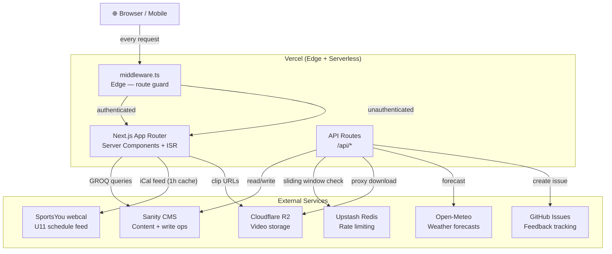
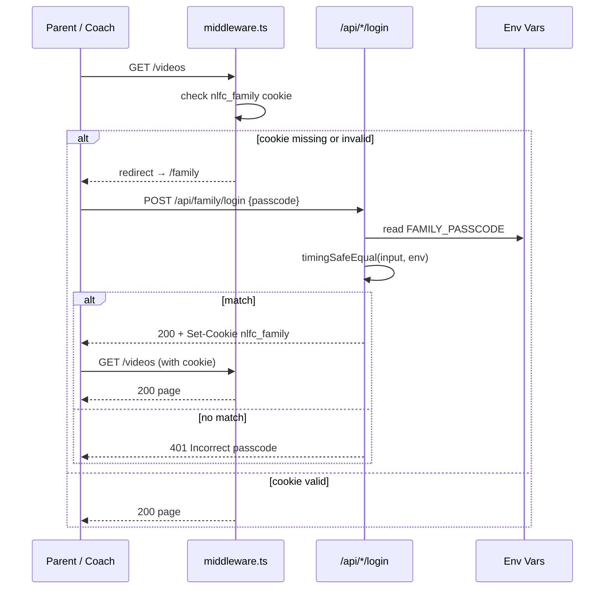
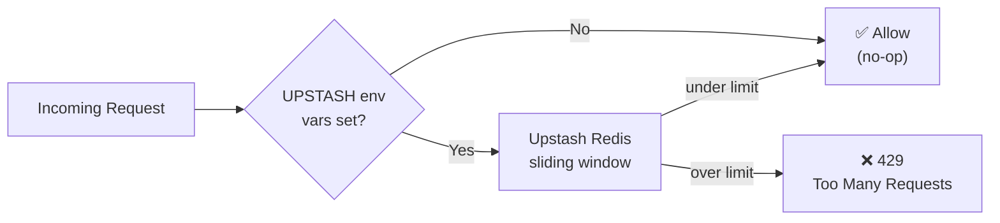
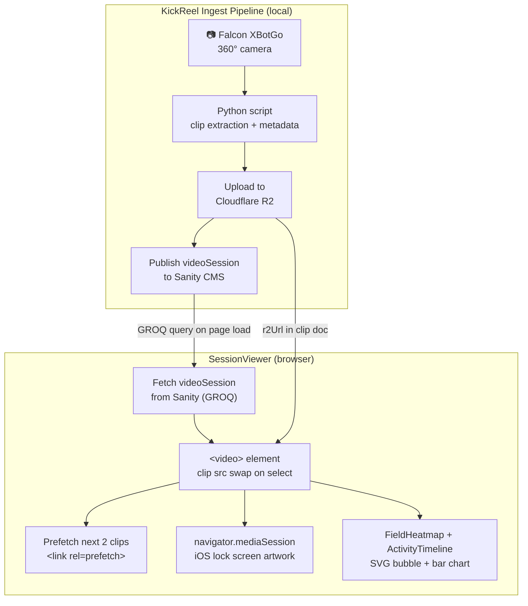
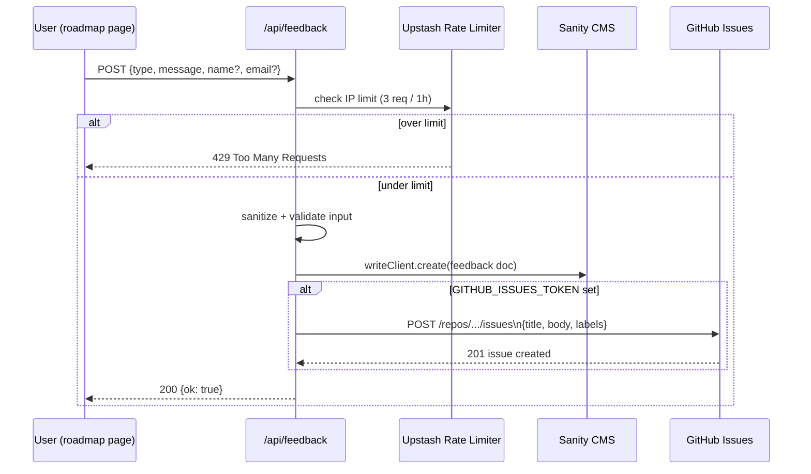

# Technical Reference — North Legends FC

Architecture, data flow, and implementation notes for contributors and maintainers.

---

## System Architecture



---

## Stack

| Layer | Technology | Notes |
|---|---|---|
| Framework | Next.js 16, App Router | Turbopack in dev, ISR in prod |
| Language | TypeScript (strict) | `noUncheckedIndexedAccess` enabled |
| Styling | Tailwind CSS v4 | Utility-first, no CSS modules |
| CMS | Sanity.io | Embedded Studio at `/studio`, GROQ queries |
| Hosting | Vercel | Edge Middleware, ISR revalidation |
| Video storage | Cloudflare R2 | No CDN until custom domain connected |
| Rate limiting | Upstash Redis + @upstash/ratelimit | Sliding window, graceful degradation |
| i18n | next-intl | EN/ES, locale resolved from cookie |
| Weather | Open-Meteo | Free, no API key |
| Schedule feed | SportsYou webcal | iCal polled hourly via Next.js fetch cache |

---

## Authentication

Two independent cookie-based gates. No user accounts — single shared secrets per role.



### Family gate
- **Route:** `POST /api/family/login`
- **Secret:** `FAMILY_PASSCODE` env var
- **Cookie:** `nlfc_family` — value is `SHA-256(passcode + "-nlfc-family-2026")`
- **Protected paths:** `/videos`, `/gallery`, `/highlights`
- Comparison uses `crypto.timingSafeEqual` to prevent timing attacks

### Admin gate
- **Route:** `POST /api/admin/login`
- **Secret:** `ADMIN_PASSWORD` env var
- **Cookie:** `nlfc_admin` — value is `SHA-256(password + "-nlfc-admin-2026")`
- **Protected paths:** `/admin/*`
- Comparison uses `crypto.timingSafeEqual`

### Middleware
`middleware.ts` runs on the Edge before every matching request. It reads cookies and redirects unauthenticated requests to the appropriate login page. The matcher covers:
- `/admin/:path+` → redirects to `/admin` (login)
- `/videos`, `/gallery`, `/highlights` → redirects to `/family` (passcode entry)

---

## Rate Limiting



`lib/ratelimit.ts` wraps `@upstash/ratelimit` with a graceful degradation pattern: if `UPSTASH_REDIS_REST_URL` / `UPSTASH_REDIS_REST_TOKEN` are not set, the function returns `null` (allow) instead of throwing.

| Key | Limit | Window |
|---|---|---|
| `login` | 5 requests | 15 minutes |
| `feedback` | 3 requests | 1 hour |
| `download` | 60 requests | 1 minute |
| `save` | 20 requests | 1 minute |

The limit key is derived from the client IP. Applied at the top of each API route handler before any other processing.

---

## API Routes

| Method | Path | Auth | Description |
|---|---|---|---|
| `POST` | `/api/family/login` | None | Validates family passcode, sets `nlfc_family` cookie |
| `POST` | `/api/admin/login` | None | Validates admin password, sets `nlfc_admin` cookie |
| `POST` | `/api/admin/logout` | None | Clears `nlfc_admin` cookie |
| `POST` | `/api/feedback` | None | Saves feedback to Sanity; optionally creates GitHub issue |
| `GET` | `/api/calendar/[team]` | None | Returns `.ics` calendar file for a given team |
| `GET` | `/api/weather` | None | Proxies Open-Meteo forecast for a lat/lon |
| `POST` | `/api/clip-save` | None (rate limited) | Increments save count on a Sanity clip document |
| `GET` | `/api/clip-download` | None (rate limited) | Proxies R2 clip download — validates host to prevent SSRF |
| `POST` | `/api/onboarding` | None | Creates player + coach docs in Sanity (requires `ONBOARDING_ENABLED=true`) |

### `/api/feedback` — GitHub Issues integration

When `GITHUB_ISSUES_TOKEN` is set, feedback submissions also create a GitHub issue on this repo:
- **Issue title:** `[{type}] {truncated message}`
- **Labels:** mapped from feedback type (`bug` → `bug`, `feature` → `enhancement`, `idea` → `enhancement`, others → `feedback`)
- **Body:** includes message and anonymous identifier (no name/email in the public issue)
- Token needs `issues: write` permission on this repo (fine-grained PAT)

### `/api/clip-download` — SSRF protection

Before proxying, the route checks that the target URL's host matches `ALLOWED_HOST` (defaults to the known R2 public bucket hostname). Requests to any other host are rejected with 403.

---

## Content Model (Sanity)

Schema definitions live in `schemaTypes/`. Key types:

| Type | Description |
|---|---|
| `team` | U11 or U12 team document — anchor for all other refs |
| `match` | Game fixture: date, opponent, location, score, result |
| `player` | Roster entry: name, number, position, photo, team ref |
| `post` | News/announcement: title, slug, body (Portable Text), publishedAt |
| `galleryEvent` | Photo album: title, date, images[], team ref |
| `highlightVideo` | YouTube highlight: title, url, thumbnail |
| `practiceSession` | Practice session with videoSession sub-doc (KickReel) |
| `videoSession` | Match recording: clips[], analytics JSON, half breakdown |

All content is fetched via GROQ queries in `lib/sanity/queries.ts`. **Never interpolate user input into GROQ strings** — always use `$param` bindings (e.g., `*[_type == "match" && _id == $id]`).

---

## KickReel Video Player

The main video experience lives in `app/videos/[sessionId]/SessionViewer.tsx`.



**Data flow:**
1. Session page fetches the `videoSession` document from Sanity (clips, analytics, half metadata)
2. `SessionViewer` renders the `<video>` element and a clip list
3. Clips are grouped by half (`1st`, `2nd`, `Celebration`) and goal status
4. On clip change: video `src` swaps, `navigator.mediaSession.metadata` updates (iOS lock screen), next 2 clips prefetch via `<link rel="prefetch">`
5. Analytics tab shows `FieldHeatmap` (SVG bubble overlay) and `ActivityTimeline` (per-half bar chart)

**Video storage:** R2 public bucket — `pub-*.r2.dev` direct URLs. No CDN cache until `northlegensfc.com` is connected. Once connected, update `r2Url` fields in Sanity to use `videos.northlegensfc.com/...` and update `ALLOWED_HOST` in the download route.

---

## Feedback → GitHub Issues Flow



---

## Internationalization

`next-intl` handles EN/ES. Locale is resolved from a cookie (set by the language picker in the nav) — **not** from the URL path. This means:
- No `/en/` or `/es/` URL prefixes
- `getLocale()` is called server-side in page components
- Bilingual page content is kept as a `CONTENT = { en: {...}, es: {...} }` object inline in each page file (roadmap, schedule, etc.)
- When adding user-facing text, always add both languages

---

## Foldable / Dual-Screen Support

`app/globals.css` includes a `@media (horizontal-viewport-segments: 2)` block targeting devices like the iPhone Duo (foldable inner screen):

```css
@media (horizontal-viewport-segments: 2) {
  .fold-two-panel {
    display: grid;
    grid-template-columns:
      env(viewport-segment-width 0 0, 50%)
      env(viewport-segment-width 1 0, 50%);
  }
  .fold-panel-left  { position: sticky; top: 4rem; … }
  .fold-panel-right { overflow-y: auto; … }
  .fold-hide        { display: none; }
}
```

The video session page wraps its content in `.fold-two-panel` — video on the left panel, clips/analytics on the right.

---

## Security

| Control | Implementation |
|---|---|
| CSP | `next.config.ts` headers — `script-src`, `img-src`, `connect-src` set. Requires `unsafe-inline`/`unsafe-eval` for Next.js hydration and Sanity Studio. Move Studio to subdomain to tighten. |
| HSTS | `max-age=63072000; includeSubDomains; preload` (2 years) |
| X-Frame-Options | `DENY` |
| X-Content-Type-Options | `nosniff` |
| Referrer-Policy | `strict-origin-when-cross-origin` |
| Permissions-Policy | Disables camera, microphone, geolocation |
| Timing-safe compare | All password/passcode checks use `crypto.timingSafeEqual` |
| GROQ injection | All user values passed as `$param` bindings, never interpolated |
| SSRF | clip-download validates host against `ALLOWED_HOST` constant |
| Input sanitization | All API routes trim + slice string inputs to max lengths before persisting |
| Rate limiting | Upstash sliding window on all write and auth routes |

**Rotate `SANITY_WRITE_TOKEN` periodically** — it backs three unauthenticated public routes (feedback, clip-save, onboarding).

---

## Dev Session Tracker

`lib/data/tracker.ts` is a static data file (not a database) that records:
- `SESSIONS` — dev work sessions with hours, commits, feature list, Claude API cost
- `KICKREEL_RUNS` — pipeline runs (clips extracted, R2 upload status, Sanity publish status)
- `SERVICES` — third-party services with monthly/annual cost breakdown

Displayed at `/admin/tracker`. Update this file manually at the end of each work session.

---

## Key Files Quick Reference

| File | Purpose |
|---|---|
| `middleware.ts` | Edge route guards for family + admin gates |
| `lib/ratelimit.ts` | Rate limiter wrapper (Upstash, graceful degradation) |
| `lib/family-auth.ts` | Family cookie hash + validation helpers |
| `lib/admin-auth.ts` | Admin cookie hash + validation helpers |
| `lib/sanity/client.ts` | Sanity read/write client setup |
| `lib/sanity/queries.ts` | All GROQ query strings |
| `lib/data/tracker.ts` | Dev session + service cost data |
| `schemaTypes/index.ts` | Sanity schema registry |
| `components/Nav.tsx` | Navigation — hamburger menu, handedness toggle (localStorage `nlfc_hand`) |
| `components/FieldHeatmap.tsx` | SVG heatmap overlay for match analytics |
| `components/ActivityTimeline.tsx` | Per-half clip activity bar chart |
| `app/videos/[sessionId]/SessionViewer.tsx` | KickReel video player + analytics |
| `i18n/routing.ts` | next-intl locale routing config |
